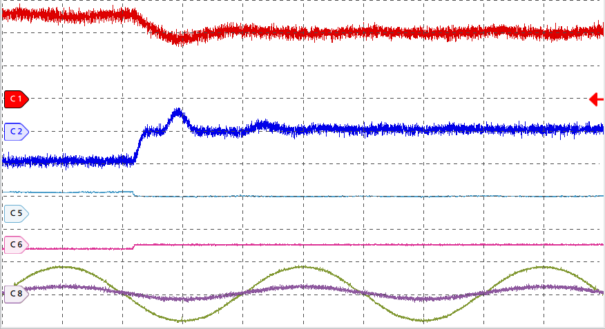
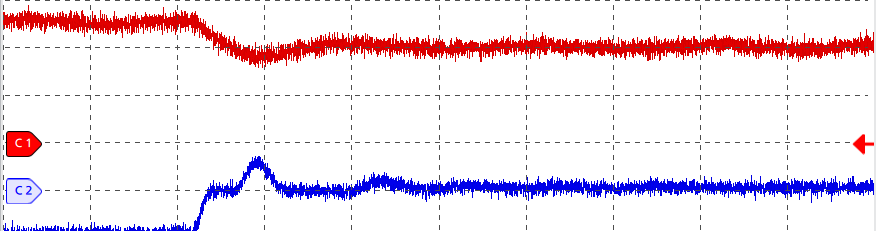

# 图像裁切工具

用于从示波器截图中提取波形细节，并按指定的毫米比例裁切图像顶部。工具只读取并生成 PNG，不修改原始图片，也不对裁切后的图像进行缩放、滤波或重采样。

> 注意：本脚本的图像裁切布局是针对实验室的示波器+示波器布局特化的，如果需要换示波器或示波器布局，需要修改脚本内部的参数。

## 功能

### 1. 提取波形细节

`crop_waveform_detail.py` 会递归查找文件名以 `_5ms.png` 结尾的截图，检查其尺寸是否为 `1920×1080`，然后自动识别上下波形区域之间的灰色控制栏。

输出文件保存于原图旁边：

```text
原图名称_5ms.png
原图名称_5ms--波形细节.png
```

当前识别规则针对本项目中的 Tektronix 截图布局：裁切区域的左边界为 `x=0`，右边界为 `x=876`，下边界为 `y=996`；上边界由灰色控制栏的下边缘自动检测。布局不匹配时脚本会报错，不会静默生成疑似错误的结果。

### 2. 按毫米比例裁切顶部

`crop_waveform_top_mm.py` 会递归查找 `--波形细节.png`，按照“原图完整高度”和“顶部保留高度”的比例裁切顶部区域。

默认参数为：

```text
顶部保留高度：33 mm
原图对应高度：68 mm
保留比例：48.53%
```

输出文件保存于原图旁边：

```text
原图名称--波形细节.png
原图名称--波形细节--顶部裁剪.png
```

这里的毫米数只用于定义裁切比例，不声明 PNG 文件实际打印尺寸；脚本不依赖 DPI，也不会改变像素的横向尺寸。

## 安装依赖

需要 Python 3 和 Pillow：

```sh
python3 -m pip install Pillow
```

如果已有项目虚拟环境，建议在虚拟环境中安装：

```sh
python3 -m venv .venv
. .venv/bin/activate
python3 -m pip install Pillow
```

## 使用方法

在本目录执行。首次运行建议先使用 `--dry-run` 检查将要处理的文件和裁切尺寸：

```sh
python3 crop_waveform_detail.py --dry-run
python3 crop_waveform_detail.py

python3 crop_waveform_top_mm.py --dry-run
python3 crop_waveform_top_mm.py
```

也可以只处理指定目录：

```sh
python3 crop_waveform_detail.py example
python3 crop_waveform_top_mm.py example
```

自定义顶部裁切比例，例如按原图高度 68 mm 保留顶部 35 mm：

```sh
python3 crop_waveform_top_mm.py example \
  --height-mm 35 \
  --original-height-mm 68
```

脚本会把派生图片写回源图片所在目录。原始图片始终保留；第二个脚本会更新同名的顶部裁切结果，因此如需保留不同参数的结果，请先复制输出或使用不同目录。

## 仓库示例

本仓库使用 `example/example_5ms.png` 作为原始示例，已生成以下两个结果：

1. 波形细节提取：`876×477`
2. 顶部裁切：`876×231`，参数为 `33/68 mm`

### 波形细节



### 顶部裁切



## 目录结构

```text
.
├── .gitignore
├── README.md
├── crop_waveform_detail.py
├── crop_waveform_top_mm.py
└── example
    ├── example_5ms.png
    ├── example_5ms--波形细节.png
    └── example_5ms--波形细节--顶部裁剪.png
```

## 限制

- 第一阶段目前要求输入截图尺寸为 `1920×1080`，且布局中存在可唯一识别的灰色控制栏。
- 文件名必须符合脚本要求的后缀：第一阶段为 `*_5ms.png`，第二阶段为 `*--波形细节.png`。
- 裁切仅改变图像边界，不增加原图中不存在的细节。
- 对不同示波器、不同窗口布局或不同截图尺寸，应先使用 `--dry-run` 验证；必要时调整脚本中的布局常量和检测规则。
